# Energy Clock

**When should you switch on the washing machine to pay less for electricity?**

Energy Clock reads the Polish day-ahead electricity market (PSE, 15-minute intervals),
shows today's and tomorrow's prices as a clock, and answers one question for a concrete
appliance: *start it at 14:45 instead of now and you will pay 0.71 PLN less*. It also shows
when the grid is cleanest, because the cheapest hour is not always the greenest one.

- Live price clock with the cheapest and most expensive windows of the day
- Appliance planner: cheapest start for a given cycle length and power draw, with constraints
  such as "finish by 07:00"
- Cheap vs. clean: two rankings side by side and the price of choosing the cleaner window
- Generation mix and carbon intensity from the PSE generation plan
- Tariff calculator: would a dynamic tariff have paid off month by month?
- Market statistics computed by the database (hour of day, weekday, renewable share,
  negative prices)
- Assistant: questions in plain language, answered by a local language model that calls
  the planner, price and tariff calculations as tools and searches the Polish Energy Law
  with article citations (RAG)
- Accounts with a household profile, own appliances and email alerts
- Embeddable widget, SVG badge, CSV export and a small JSON API
- English by default, Polish via the header switch; light and dark theme

## Who it is for

Households on a dynamic (spot-indexed) tariff, owners of heat pumps, EVs and PV
installations, and anyone curious how much the price of electricity moves during the day.
It is a portfolio project: the goal is a small, complete, well-tested Django application
with a real data pipeline, not a commercial product.

## Tech stack

| Area | Technology |
|---|---|
| Language | Python 3.13 |
| Web framework | Django 5.2, server-rendered templates, gettext translations (English, Polish) |
| Frontend | HTMX 2.0 and Alpine.js 3.17 (vendored, no build step), one CSS file, SVG charts rendered in Python, Bricolage Grotesque (self-hosted) |
| Background jobs | Celery 5.6, django-celery-beat (schedule stored in the database), django-celery-results |
| Storage and cache | SQLite in WAL mode; Redis 8 as the Celery broker and the Django cache |
| External data | PSE reports API and Sejm ELI API (legal acts), fetched with `httpx` |
| Language model | LM Studio with Gemma 4 12B QAT (chat, tool calling) and bge-m3 (embeddings), called through the `openai` SDK; any OpenAI-compatible server works |
| Static files and mail | WhiteNoise; SMTP to a local Mailpit inbox |
| Tests | pytest, pytest-django, time-machine, respx |
| Code quality | ruff, mypy `--strict` with django-stubs |
| Environment | Docker Compose (web, worker, beat, Redis, Mailpit), `make.ps1` task runner |

## Architecture

```
PSE reports API ──httpx──▶ apps.market (ingest, models, stats)
                              │  SQLite (WAL), UTC in the database
Celery beat ─▶ worker ────────┤  Redis: broker + Django cache
                              ▼
                       apps.planner (optimizer, tariff, alerts)
                              ▼
                       apps.web (views, SVG charts, i18n, API, widget)
                              ▼
               Django templates + HTMX + Alpine.js + one CSS file
```

| Layer | What it does |
|---|---|
| `apps/market` | PSE client with pagination and retries, idempotent ingest keyed by `dtime_utc`, DST-aware interval counting (92 / 96 / 100 per day), carbon intensity estimate, Celery tasks and beat schedule, backfill command, database-side statistics |
| `apps/planner` | Pure optimizer (`cheapest_window`, `greenest_window`, `cost_if_started_now`, non-overlapping rankings), appliance templates, tariff simulator with exact daily profiles (`Fraction` weights), household, alerts with once-per-day delivery |
| `apps/web` | Server-rendered pages and HTMX partials, SVG charts built in Python, cookie-based language and theme, accounts, JSON API, CSV export, widget |
| `apps/assistant` | LLM client over the OpenAI-compatible API, agent loop with four tools, Energy Law ingest (ELI HTML parser, chunking, embeddings), hybrid search with a retrieval eval, answer script guard, query log |

How the assistant answers a question:

```
question ─▶ agent ──messages + tool schemas──▶ language model (LM Studio)
              │  ◀──────── tool calls ────────┘
              ├─ find_cheapest_window ─▶ apps.planner build_plan
              ├─ get_day_prices ───────▶ apps.planner summarize_day
              ├─ compare_tariff ───────▶ apps.planner simulate_tariff
              └─ search_energy_law ────▶ LawChunk vectors in SQLite ◀─ ingest_law ◀─ Sejm ELI API
              │  tool results go back to the model, at most 4 rounds
              ▼
answer + cited articles ─▶ /assistant    answer + tools, tokens, time ─▶ /api/ask, admin log
```

Schedule (Celery beat, stored in the database via django-celery-beat):

| When (Europe/Warsaw) | Task |
|---|---|
| 14:15, 15:15, 16:15 | fetch tomorrow's prices, retry with backoff while PSE has not published yet, then check alerts |
| every hour at :05 | fetch today's and tomorrow's generation plan |
| 03:30 | fill gaps from the last 7 days |
| 04:00, 15:00 | warm the statistics cache |
| worker start | fill gaps, so a machine that was off catches up by itself |

## Design decisions

**SQLite instead of PostgreSQL.** Two years of 15-minute prices and generation plans are
about 160 000 rows; the whole database is a few tens of megabytes and every query here
runs in milliseconds. WAL mode lets the web server and the Celery worker write
concurrently. Running a database server for this volume would be ceremony. Switching to
PostgreSQL is a one-dictionary change in `config/settings.py`; the only SQLite-specific
code is the pragma receiver in `apps/market/sqlite.py`.

**HTMX and Alpine.js instead of a single-page application.** The interactions are few and
well defined: switch a day, recompute a plan, change a form. Django renders complete
pages, HTMX swaps fragments, Alpine.js handles local reactivity (sliders with an instant
cost preview). There is no build step, every page works with JavaScript disabled, and the
charts are SVG generated on the server, so the same code renders the README badge.

**Celery beat instead of cron.** PSE publishes tomorrow's prices around 14:00, sometimes
later. The fetch task retries with exponential backoff, every attempt is recorded as an
`IngestRun` visible in the admin, and the schedule lives in the database where it can be
inspected and changed. A cron line cannot express "retry until published".

**`dtime_utc` as the natural key.** PSE marks each interval with the UTC timestamp of its
*end*. On the day the clocks change a `(business_date, period)` pair is ambiguous or has
holes; UTC is monotonic. The expected number of intervals per day is computed from the
UTC offsets at the start and end of the local day, never hard-coded.

**Hourly aggregation on phones.** Ninety-six bars do not fit in 380 px. Instead of a
horizontally scrolling chart that hides the "now" marker, narrow screens get a second SVG
with one bar per hour (average price, same colour scale); the full 15-minute table stays
one tap away. Both charts are rendered server-side and switched with a media query.

**Theme in a cookie.** The server renders `data-theme` from the cookie, so the dark palette
is applied before the first paint and there is no flash. Without a cookie the page follows
`prefers-color-scheme`. The dark theme is a separate palette, not an inversion.

**Redis as the Django cache.** Statistics over 80 000 intervals take a few seconds to
aggregate; they are cached for six hours in Redis (shared by the web server and the
worker) and warmed by a Celery task after each publication.

**English default, Polish second.** Every string goes through gettext; the language lives
in a cookie and is never guessed from `Accept-Language`, so the default is stable.

**The language model never computes numbers.** Every price, cost, saving and time in an
answer comes from a tool built on the existing, tested code (`build_plan`,
`summarize_day`, `simulate_tariff`). The model only chooses the tool, fills in its arguments
and phrases the result. Arguments go through the same Django forms as the planner and the
tariff pages, so the model gets the same validation errors as a person and can correct
itself. The page shows the answer and the articles it cites; the tools called, their
arguments, tokens and time go to the admin log and the JSON endpoint.

**Chunks follow the structure of the act.** The Energy Law comes from the Sejm ELI API as
HTML with marked-up chapters, articles, passages (ust.) and points (pkt). A chunk is one
article; a long article is split only between passages or points, never inside one, and
the chapter and article number are embedded together with the text, so a passage like
"2. Umowy, o których mowa w ust. 1..." still says what it belongs to. Editorial footnotes,
which the HTML inlines in the middle of sentences, and provisions of other acts quoted in
the announcement are dropped. Cutting every 1 000 characters would split definitions in
half and separate passages from their article.

**Hybrid search, measured.** Embeddings alone failed on a real question: the model searched
for "obowiązek oferowania taryfy dynamicznej przez dostawcę energii" in everyday words,
while the act speaks of "umowa z ceną dynamiczną" and "sprzedawca", and the right passage
fell to seventh place. Search now merges the cosine ranking with a keyword ranking
(IDF-weighted overlap of six-letter stems, a crude answer to Polish inflection) by
reciprocal rank fusion, and the tool description asks the model to search in the words of
the act. `python manage.py eval_law_search` runs eight fixed questions and reports where
the right passage lands:

| Retrieval | recall@4 | MRR@20 |
|---|---|---|
| embeddings only | 7/8 | 0.70 |
| embeddings + keywords (weight 0.5, k = 10) | 8/8 | 0.81 |

Eight questions are a sanity check, not a benchmark; the point is that every change to
chunking or ranking can be measured instead of guessed. Smaller chunks were measured too
and were worse (1 000 characters: 5/6 on the first question set, against 6/6).

**Vector search in SQLite, no vector database.** The act is about 550 chunks of 1 024
dimensions; the whole hybrid search over all of them takes 0.14 to 0.21 s, and the query
embedding 30 ms. Qdrant or pgvector would add a service without making anything faster at
this size; they become worth it at tens of thousands of chunks.

**Answers are checked for the alphabet.** Small multilingual models occasionally slip a
Cyrillic word into a Polish answer ("procedurę" came back as "процедуrę"). Every answer
is checked letter by letter against the Unicode Latin script; a contaminated answer goes
back to the model once with a request to rewrite it in the Latin alphabet without changing
numbers or article references, and if the rewrite is still contaminated it is not shown at
all. Rewrites and rejections are logged in the admin.

**No agent framework.** The agent is a short loop: send the question with the tool
schemas, run the requested tools, send the results back, at most four rounds. LangChain or
LangGraph would add a layer of abstraction without adding capability for four tools.
Talking to the OpenAI-compatible API keeps the provider swappable: LM Studio locally,
OpenAI or any other server by changing `LLM_*` in `.env`.

**A model sized for the GPU, thinking switched off.** Gemma 4 12B QAT has about 7 GB of
weights; with bge-m3 and a 64k context the models take about 10 GB of VRAM. Its reasoning
mode is off (`reasoning_effort: none`): a tool call then takes about 0.6 s instead of 2 s,
and whole answers take 1 to 4 s at about 87 tokens per second on an RTX 5070 Ti. Choosing
which tool to call does not need a chain of thought.

## Caveats, shown in the interface as well

- **Wholesale prices, not your bill.** PSE publishes day-ahead market prices. Your supplier
  adds a margin, and distribution fees, excise duty and VAT come on top. The application
  shows *relative* differences within the day; they translate into savings only on a
  dynamic tariff.
- **Savings are estimates.** Costs assume a constant power draw for the whole cycle. A real
  washing machine does not draw 2 kW evenly for two hours.
- **Carbon intensity is approximate.** It is derived from the *planned* generation mix with
  0 g/kWh for solar and wind and 750 g/kWh for conventional units, a rough average for the
  Polish mix; imports, grid losses and the real efficiency of individual plants are ignored.
  Values are always shown with "≈".
- **History starts on 14 June 2024**, when the Polish 15-minute day-ahead market started.
  The tariff calculator cannot look further back.
- **No password reset.** Mail goes only to the local Mailpit inbox, so there is no way to
  deliver a reset link. Accounts are email plus password, nothing else.
- **The assistant runs a small local model.** The numbers come from the tools, but the
  wording can be imprecise and the model can occasionally pick the wrong tool; the articles
  an answer relies on are shown under it, and every call is logged in the admin. Legal
  answers are based on the consolidated text Dz.U. 2024 poz. 266, the newest one available
  as HTML (Dz.U. 2026 poz. 43 is published only as PDF), so later amendments are missing.
  It is not legal advice.

## Running it

Requirements: Docker Desktop with the Compose plugin. Nothing is installed on the host.

```powershell
./make.ps1 up        # redis + mailpit
./make.ps1 migrate
./make.ps1 backfill  # optional: download the price history (a few minutes)
./make.ps1 dev       # web on http://127.0.0.1:8000, worker, beat
```

A `.env` file is optional. Without it the development defaults apply; to set your own
`DJANGO_SECRET_KEY`, copy `.env.example` to `.env` and fill it in. Empty values fall back
to the defaults. `.env` is ignored by git.

Useful addresses: application `http://127.0.0.1:8000`, Mailpit `http://127.0.0.1:8025`,
admin `http://127.0.0.1:8000/admin/` (create a superuser with `./make.ps1 super`).

### Assistant (optional)

Everything except the Assistant page works without a language model. For the assistant:

1. In [LM Studio](https://lmstudio.ai/) download `google/gemma-4-12b-qat` and the embedding
   model `gpustack/bge-m3-GGUF`, then start the local server (Developer tab, or
   `lms server start`).
2. Load both models explicitly. Models loaded on demand evict each other, and every legal
   question would then reload them:

   ```powershell
   lms load google/gemma-4-12b-qat -c 32768 --gpu max
   lms load text-embedding-bge-m3 --gpu max
   ```

3. Index the Energy Law (downloads the act and embeds about 550 chunks in 15 s), then
   optionally check retrieval quality:

   ```powershell
   ./make.ps1 law
   docker compose -p energy-clock run --rm web python manage.py eval_law_search
   ```

The containers reach LM Studio at `http://host.docker.internal:1234/v1`. To use another
OpenAI-compatible server, set `LLM_BASE_URL`, `LLM_MODEL`, `LLM_EMBEDDING_MODEL` and
`LLM_API_KEY` in `.env`, and `LLM_REASONING_EFFORT=omit` if the server does not know that
parameter. API keys belong only in `.env`, which git ignores. Every question is logged in
the admin under *Assistant queries* with the tools called, tokens and time.

Quality gates:

```powershell
./make.ps1 test      # pytest, offline (live PSE tests are opt-in via -m live)
./make.ps1 lint      # ruff
./make.ps1 types     # mypy --strict
```

## Reproducing the data

The database is not in the repository (`data/` is ignored; `data/MANIFEST.md` documents the
source). One command downloads the whole history:

```powershell
./make.ps1 backfill
```

or, inside the container, with a range or a single endpoint:

```bash
python manage.py backfill --start 2026-01-01 --end 2026-03-31
python manage.py backfill --endpoint prices
```

Backfill skips days that are already complete, so it can be re-run at any time. The full
history from 14 June 2024 is roughly 80 000 price intervals and takes a few minutes.

## API and export

| Endpoint | Description |
|---|---|
| `/api/prices?date=2026-09-04` | one day of prices with the generation plan and carbon intensity |
| `/api/windows?duration=120&power=2.0&finish_by=07:00` | cheapest, greenest and "start now" windows for a cycle |
| `/export.csv?start=2026-09-01&end=2026-09-07` | CSV of prices and generation, up to 400 days |
| `/widget` | embeddable page for an `<iframe>` |
| `/widget.svg` | server-rendered badge for a README |
| `/api/ask?q=When should I run the dishwasher?` | assistant answer with the tools called, cited articles, tokens and time; 503 when the model is not reachable |

All money values are strings to preserve decimals; timestamps are ISO 8601 in UTC and in
Europe/Warsaw.

## Development notes

- `Decimal` everywhere money or power is involved.
- Tests use fixtures with real PSE data for 4 and 5 September 2026 and never touch the
  network; `time-machine` freezes the clock. Assistant tests replace the language model
  with a fake client or `respx` and parse a small inline copy of the ELI markup, so they
  run without LM Studio.
- Translations: `python manage.py makemessages -l pl` and `compilemessages` (gettext is in
  the image); the compiled catalog is committed so a clean clone runs in both languages.
- Font: Bricolage Grotesque, self-hosted under the SIL Open Font License
  (`static/fonts/OFL-BricolageGrotesque.txt`).

## Screenshots

Taken from a local instance with the full PSE history (14 June 2024 – 2 November 2026).

**Price clock**: today's 15-minute prices, the current interval and the cheapest
and most expensive windows.

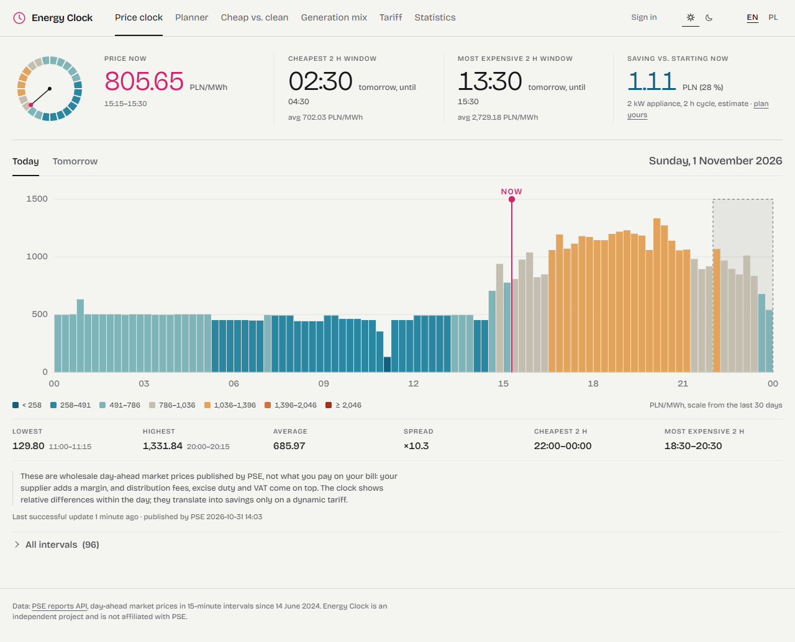

**Appliance planner**: a washing machine that has to finish by 07:00 starts at 02:30
tomorrow and costs 28 % less than starting now.

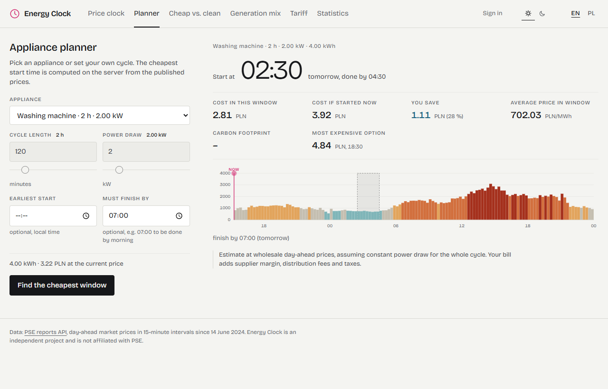

**Cheap vs. clean**: the cheapest and the cleanest two-hour window of the day, with the
price of choosing the cleaner one.

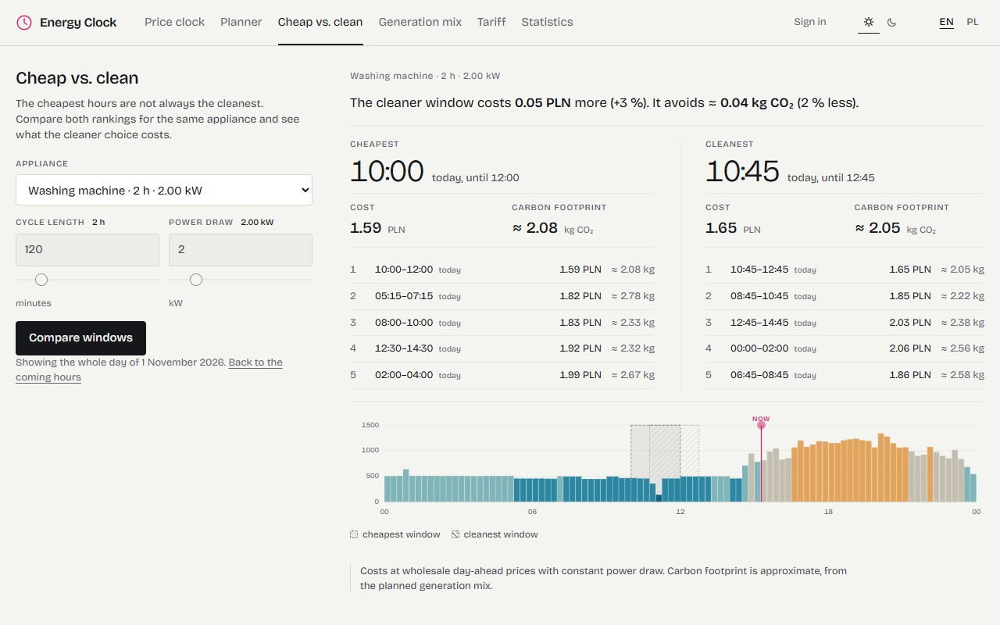

**Generation mix**: planned solar, wind and conventional generation with the estimated
carbon intensity on the right axis.

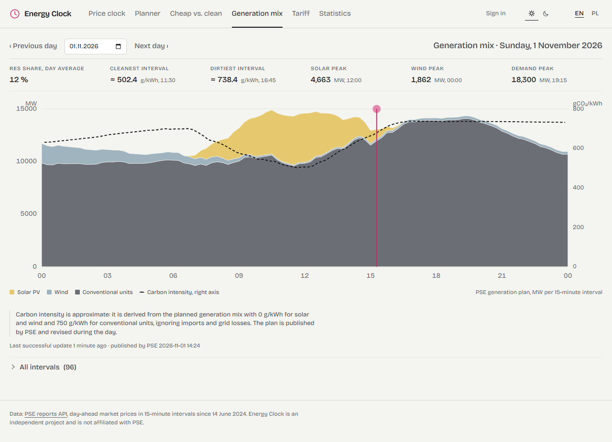

**Tariff calculator**: the last twelve months replayed on a dynamic tariff against a
fixed price.

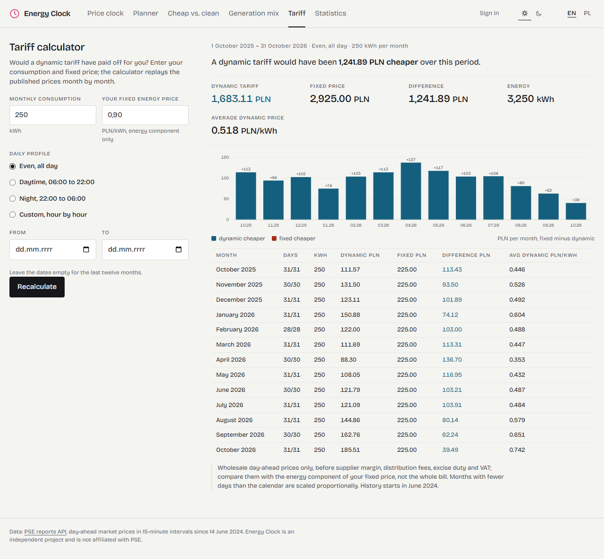

**Market statistics** computed by the database over the whole history.

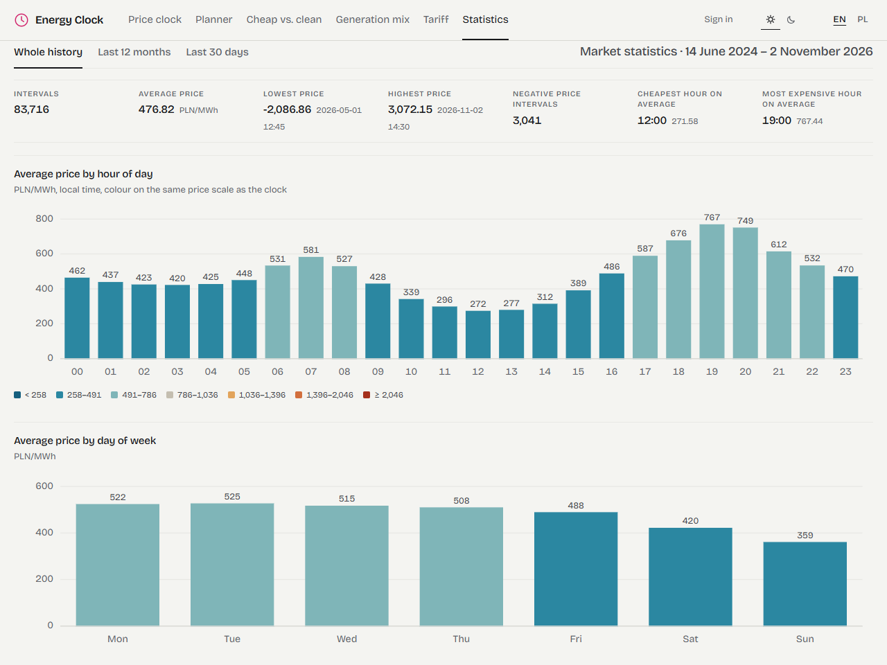

<table>
  <tr>
    <td width="66%"><strong>Dark theme</strong><br>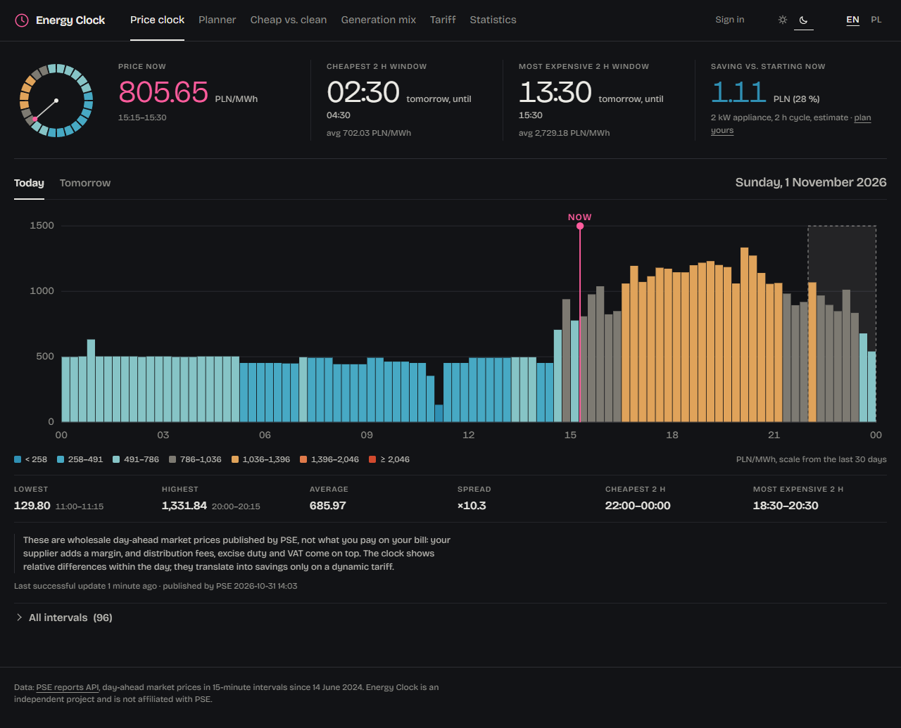</td>
    <td width="34%"><strong>Phone, hourly chart</strong><br>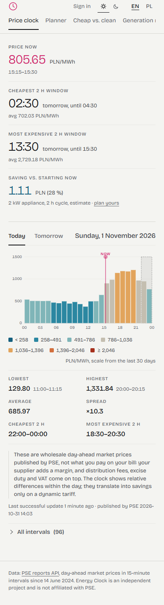</td>
  </tr>
</table>

**Assistant**, legal question: the model searched the Energy Law and cites the articles it
found; the articles can be expanded under the answer.

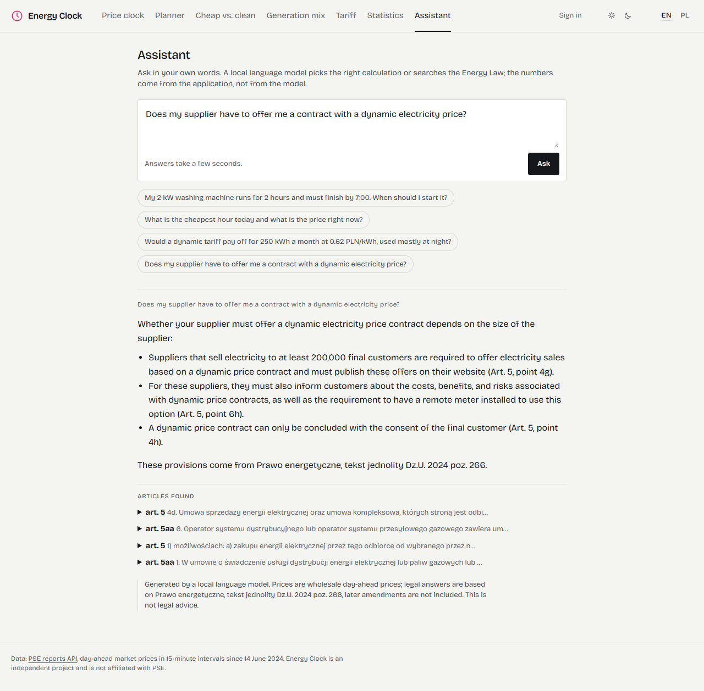

**Assistant**, planning question: the model called the planner, every number in the answer
comes from it.

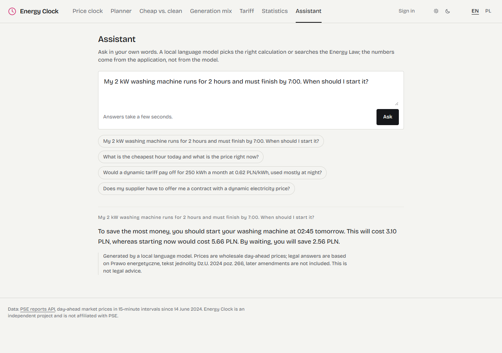

**Embeddable widget**, as it looks inside an `<iframe>`:

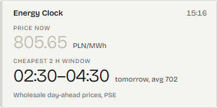

## Attribution

Price and generation data come from the public
[PSE reports API](https://api.raporty.pse.pl/) (Polskie Sieci Elektroenergetyczne):
`csdac-pln` for day-ahead prices and `pdgobpkd` for the generation plan. Energy Clock is an
independent project and is not affiliated with PSE.
